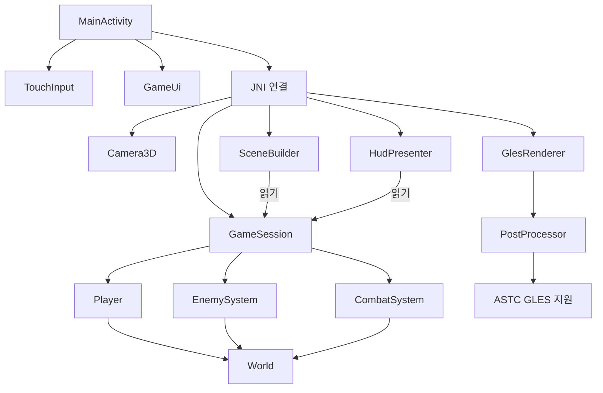

# 아레나 모듈 정의

현재 한 Android 앱 안에서 책임별 코드 모듈을 분리한다. 네이티브는
`arena_engine`(충돌·이펙트), `arena_gameplay`(게임 로직), `arena_graphics`(GPU), `arena`(JNI 연결)로 빌드한다.
게임 로직에는 Android·EGL·GLES 의존성이 없다.

## 앱·입력·UI

| 모듈 | 파일 | 책임 |
|---|---|---|
| 앱 호스트 | `MainActivity.kt` | Activity·Surface 수명, 메뉴 전환, 렌더 스레드, 전체 화면·뒤로 가기 |
| 터치 입력 | `TouchInput.kt`, `VirtualControls.kt` | 가상 스틱·멀티터치 포인터 소유·불변 입력 스냅샷 |
| 화면 UI | `GameUi.kt` | 메뉴·플레이 버튼·HUD 뷰 생성 |
| JNI 연결 | `native.cpp` | 한 라운드와 렌더러 소유, 입력 전달, 장면 렌더링, HUD 반환 |

Kotlin은 UI 스레드에서 뷰를 변경한다. GPU 생성·프레임 처리·해제는 같은
렌더 스레드에서 수행한다. Surface 재생성 시 기존처럼 라운드가 초기화된다.

## 조작 설정·오디오

`ControlSettings.kt`는 모드·좌우 배치·효과음 설정을 SharedPreferences에 저장한다.
`AudioSystem.kt`는 게임 이벤트를 SoundPool 효과음으로 연결하고 앱 수명에 맞춰
일시 정지·재개·해제한다. `res/raw/*.wav`는 직접 합성한 PCM 효과음이다.

## 게임 로직

모든 파일은 `app/src/main/cpp/gameplay/`에 있다.

| 모듈 | 파일 | 소유 상태·책임 | 주요 API |
|---|---|---|---|
| GameSession | `game_session.h` | 라운드 나이·점수, 플레이어·적·전투 소유, 업데이트 순서·게임 오버 | `update`, `gameOver` |
| Player | `player.h` | 위치·체력, 이동·피해 | `move`, `damage`, `alive` |
| EnemySystem | `enemy_system.h` | 적 목록·생성 타이머·난수, 생성·추적·사망 정리 | `spawnEnemies`, `chase`, `removeDead` |
| CombatSystem | `combat_system.h` | 탄환·탄약·발사/재장전 타이머·조준, 충돌 처리 | `updateWeapon`, `resolve` |
| World | `world.h` | 정규화 좌표 규약, 이동 경계, 충돌·범위 판정, 월드 좌표 변환 | `constrainPlayer`, `overlaps`, `outside`, `toWorld`, `toGround` |

`GameSession`이 프레임 시간을 0~0.05초로 제한하고 다음 순서로 갱신한다.

1. 게임 오버면 정지
2. 라운드 나이 → 플레이어 이동 → 적 생성
3. 조준·발사·재장전 → 적 추적 → 탄환 이동·충돌·피해
4. 처치 점수 반영

게임 모듈은 화면을 그리지 않는다. `game.h`는 기존 include 경로를 위한
`Game = GameSession` 별칭만 제공한다. 이전의 평면 상태 필드·`scene()` 대신
`game.player`, `game.enemySystem`, `game.combat`, `SceneBuilder::build(game)`를 쓴다.

## 엔진 기반

`engine/collision.h`는 Vec3·AABB·이동 구간 충돌을, `engine/effects.h`는 3D 입자·
섬광 타이머·화면 흔들림·사격/피격/피해 이벤트를 소유한다. World는 이 기반을
사용해 맵 엄폐물·이동·시야 판정·우회 지점을 제공한다. 실제 플레이 정의는
[GAME_DESIGN.md](GAME_DESIGN.md)에 있다.

## 장면·그래픽·에셋

| 모듈 | 파일 | 책임 |
|---|---|---|
| Camera3D | `camera3d.h` | 고정 원근 카메라 상수, 화면 터치 → 지면 좌표 |
| SceneBuilder | `scene_builder.h` | 읽기 전용 게임 상태 → 바닥·벽·캐릭터·탄환·조준 표시 박스 |
| HudPresenter | `hud_presenter.h` | 읽기 전용 게임 상태 → 체력·탄약·점수·게임 오버 문자열 |
| GlesRenderer | `gles_renderer.h/.cpp` | EGL·윈도우 소유, 3.2→3.1→3.0 선택, 조명 셰이더·VAO/VBO·박스 그리기, 화면 표시 |
| PostProcessor | `post_processor.h/.cpp` | 장면/출력 FBO·깊이 버퍼·텍스처, 화면 크기 변경, 컴퓨트/프래그먼트 후처리·출력 복사 |
| ASTC GLES 지원 | `astc_gles.h/.cpp` | GPU 지원 검사, ASTC 포맷·디코드 선택·밉 업로드, 컴퓨트 복사 프로그램 |
| 공통 장면 타입 | `render_types.h` | `Box`, `GroundPoint`; 게임 상태 소유 없음 |

`GlesRenderer`가 `PostProcessor`를 소유하고 EGL 컨텍스트 해제 전에 파괴한다.
3.2·3.1은 컴퓨트 후처리, 3.0은 프래그먼트 후처리를 쓴다. ASTC 지원은
컨텍스트 버전과 별도로 조회한다. 게임에는 아직 압축 텍스처 에셋이 없다.

## 다음 기능의 소유 위치

새 무기·재장전 규칙은 CombatSystem, 적 종류·생성 패턴은 EnemySystem,
난이도·승패 조건은 GameSession, 장애물·충돌 규칙은 World에 추가한다.
모델·재질을 도입할 때 SceneBuilder의 출력 타입을 확장하고, GPU 업로드는
그래픽/에셋 쪽에서 처리한다.

모델·파일 로더는 아직 구현되지 않았다. 추후 AssetLoader는 에셋 ID·로드·캐시·해제를 맡는다.
현재 효과 이벤트는 게임에서 JNI로 전달하고 AudioSystem이 재생한다.

## 검사

`tests/game_test.cpp`는 결정적 진행, 이동 경계, 접촉 피해, 탄환 처치·점수,
게임 오버 정지, 탄창·재장전, 장면 유효성, 카메라 매핑, HUD 표시를 검사한다.
GLES 코드는 이 검사에 포함되지 않으며 앱 실행으로 별도 확인한다.

Android 입력 통합 검사는 `ControlsInstrumentation.java`에서 두 손가락 동시 입력,
해제·취소, 자동 모드, 좌우 교환, 설정 저장을 검증한다. 추가 테스트 라이브러리 없이
프레임워크 Instrumentation을 사용한다.

## Native status UI (2026-10-12)

- `HudPresenter::state`: gameplay snapshot as numeric JSON, consumed by `HudState`.
- `GameHud`: dedicated region above the SurfaceView; semantic warning/error/success states.
- `ArenaTheme`: OpenIntelligentUI MIT dark theme token adaptation (see THIRD_PARTY_NOTICES.md).
- `MainActivity`: safe display insets, gameplay Back → home, home Back → finish.

Fullscreen revision: SurfaceView and sticks fill the window; GameHud floats above them. Cutout-safe padding applies only to the HUD overlay, not the render surface.

## Shared GLES output modules (2026-10-12)

- `gl_program.h/.cpp`: `graphics::createProgram(stages)` compiles and links vertex/fragment or compute programs. Releases temporary shaders on success and failure; deletes a failed program. The caller owns the returned linked program.
- `frame_output.h/.cpp`: `graphics::FrameOutput` manages output selection. `Direct` binds framebuffer 0 and performs no postprocess copy. `DiagnosticCopy` owns the optional `PostProcessor`; it retains compute on GLES 3.1+ and fragment on GLES 3.0.
- `GlesRenderer`: EGL context, geometry and swap ownership; delegates output and program creation. All resources are destroyed on the renderer thread before EGL teardown.
- `PostProcessor`: optional diagnostic copy resources, no longer constructed for normal gameplay.

Normal flow: begin default framebuffer → draw scene → EGL swap.
Diagnostic flow: begin offscreen scene → draw scene → copy → blit → EGL swap.
Select diagnostic output explicitly with `GlesRenderer(window, graphics::OutputPath::DiagnosticCopy)`.

## Combat progression modules

- `gameplay/weapon.h`: shared weapon specification table.
- `Player`: dash state, collision-aware movement, cooldown and speed upgrade.
- `GameSession`: round orchestration, delegates wave transitions and upgrades to `ProgressionSystem`.
- `EnemySystem` / `SceneBuilder`: locked attack windup and directional telegraphs.
- `ProgressStore.kt`: local weapon selection and completed-run record persistence.
- `UpgradePanel.kt`: modal three-choice upgrade UI.
- `MainActivity`: atomic dash/upgrade requests consumed on renderer thread via JNI.

## Extracted progression and weapon UI (2026-10-12)

- `gameplay/progression_system.h`: owns 5-wave timing constants, next upgrade boundary, pause state, choice validation, stacked stat changes and transition cleanup/refill. Independent of GameSession/JNI/UI.
- `GameSession`: forwards `upgrading()`, `chooseUpgrade()` and `checkWave()` to its owned progression object; owns the round's player/combat/enemy instances.
- `WeaponPicker.kt`: weapon selection button, description list and dialog; returns a weapon ID through a callback. It does not own persistence.
- `MainActivity`: binds WeaponPicker selection to ProgressStore and refreshes the menu; no weapon dialog construction or stat upgrade rules.

## Shared selection dialogs

- ArenaDialog.kt owns themed modal sizing, scrollable content, fixed actions and tinted option rows.
- GameUi and WeaponPicker supply options and callbacks; settings commit only on Save.

## Compressed textures

- `compressed_texture`: common complete mip-chain validation and GPU upload for ASTC and ETC.
- `etc_gles`: ETC1, ETC2 and EAC format capabilities, block-size table and demo floor texture.
- `GlesRenderer`: owns floor texture lifetime and material sampling; SceneBuilder marks the floor material.
- See `ETC_TEXTURES.md` for supported inputs and S24 validation.

## Advanced scene rendering

For current shared capability, codec, UI and optimization ownership, see
`UNIFIED_MODULES.md`. The common material path now supports selectable ETC1,
ETC2 and ASTC without changing ScenePipeline.

- `ScenePipeline`: static cube, instance streaming, frame UBO, depth shadow target and lighting shaders.
- `GlesRenderer`: EGL/frame orchestration and floor texture lifetime; delegates geometry to ScenePipeline.
- `ADVANCED_RENDERING.md`: pass order, costs, compatibility and real-device test evidence.

