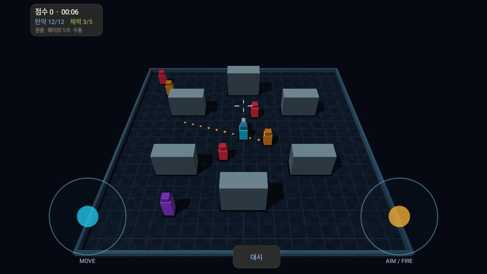

# Vulkan Arena Demo Feat.GPT 6.1 Sol

Android용 **Kotlin + C++ Vulkan 3D 렌더링 데모**.
기존 GLES 생존 슈터의 게임·UI를 유지하고 그래픽 API를 Vulkan으로 교체했습니다.



## 기능

- Vulkan 1.0 코어, Android Surface·Swapchain·FIFO 화면 표시.
- GPU 인스턴싱, 프레임 UBO, 1024² 그림자와 수동 3×3 PCF.
- 픽셀 조명·윤곽광·안개, 탄환·파티클 발광.
- ASTC 4×4 / ETC2 RGB / RGBA8 밉 텍스처와 최대 8× 이방성 필터링.
- ETC1 선택은 ETC1 호환 블록을 ETC2 RGB 경로로 업로드.
- 재사용 인스턴스 벡터, 지속 매핑 버퍼, 변경 시 디스크립터 갱신.
- 정적 메시 초기 GPU 업로드, 슬롯별 fence·이미지별 표시 semaphore.
- 정적 장면 최초 업로드·동적 장면 갱신, 슬롯별 UBO/인스턴스 버퍼 통합.
- 56바이트 JNI 상태 버퍼 재사용, 단일 렌더 스레드와 세마포어 종료 확인.
- 화면 크기 변경 시 전투 유지·호환 파이프라인과 정적 자원 재사용.
- Android Choreographer 프레임 페이싱, 비동기 GPU 시간 측정.
- 자동/양손 조작·대시·엄폐물, 무기 3종·적 조합·웨이브·강화·기록.
- 공통 Kotlin UI·설정·HUD·게임 오버 화면, C++ ThinLTO와 R8.
- 공통 FP32 장면 ABI·프레임 슬롯 직접 기록, 중간 Box 버퍼 제거.
- Kotlin 렌더 세션·JNI 브리지·전투 UI 분리, 최신 HUD 상태 병합·입력 임시 객체 제거.
- C++ GameRuntime 소유권 분리·공통 인스턴스 검증, 배포 JNI 4개·디버그 진단 2개를 분리하는 링커 설정.

앱은 Vulkan을 직접 호출합니다. 기존 GLES 코드는 참고용으로 남아 있으며
앱 빌드에는 EGL/GLES를 연결하지 않습니다. GLES 자동 폴백과 MSAA는 현재
없습니다. 이식 구조와 검증 범위는 [Vulkan migration](docs/VULKAN_MIGRATION.md)에 있습니다.

## 빌드

| 항목 | 설정 |
|---|---|
| Android | min SDK 28 / target·compile SDK 37 |
| Java | JDK 25 |
| Gradle / AGP | 9.6.0 / 9.4.1, AGP 내장 Kotlin |
| Native | NDK 30.0.15729638 / CMake 4.1.2 / C++17 |
| ABI | arm64-v8a, x86_64 |
| GPU | Vulkan 1.0 이상 |

Android Studio에서 프로젝트를 열고 필요한 SDK·NDK·CMake를 설치합니다.
JAVA_HOME은 JDK 25, ANDROID_HOME은 로컬 Android SDK 경로로 설정합니다.

```powershell
./gradlew.bat :app:assembleBenchmark --no-daemon
adb install -r app/build/outputs/apk/benchmark/app-benchmark.apk
adb shell am start -n dev.demo.arena/.MainActivity
```

benchmark는 최적화를 켠 설치 가능한 로컬 검증 빌드입니다. 로컬 debug 키로
서명되며, 측정 하네스나 제품 배포용 서명 설정은 아닙니다.
개발용 빌드는 :app:assembleDebug를 사용합니다.

매니페스트 정책·배포 서명 환경변수·의존성 잠금은 [빌드와 서명](docs/BUILD_SIGNING.md)을 참고하세요.

## 모듈

- **공통:** 텍스처·인스턴스 검증, 버전·기능 정책, 지속 매핑 메모리.
- **렌더링:** VulkanContext·Swapchain·FrameResources·ScenePipeline·FrameClock.
- **게임:** C++ 시뮬레이션·충돌·전투·진행과 재사용 SceneBuilder.
- **UI:** Kotlin 입력·오디오·설정·공통 선택창·결과 화면.

[Vulkan 이식 상세](docs/VULKAN_MIGRATION.md) · [게임 설계](GAME_DESIGN.md).
기존 MODULES/UNIFIED_MODULES/ADVANCED_RENDERING/ETC_TEXTURES/GLES_EXTENSIONS 문서는
GLES 버전의 개발 기록으로 보존합니다.

## 검증 범위

- Android ARM64·x86_64 Debug/Benchmark 빌드 통과.
- Android 16 에뮬레이터 Vulkan: ASTC·ETC2·RGBA8 장면 readback,
  그림자 켜기/끄기와 프레임 슬롯 반복 재사용 검사 통과.
- CPU API 정책·투영·밉·타임스탬프 검사와 기존 게임 로직 검사 통과.
- Galaxy S24에서 최신 APK의 정상 작동을 사용자가 확인했습니다.
- Android 에뮬레이터에서 최신 APK 업데이트 설치·전투·게임 오버 화면을 확인했습니다.
- [S24 Sokatoa 검증 기록](docs/S24_SOKATOA_VALIDATION.md)은 짧은 캡처 기준입니다.
  GLES 대비 성능 향상률이나 터치 지연을 입증하는 비교 측정은 아닙니다.
- Vulkan 셰이더는 SPIR-V 1.0입니다. 소스 변경 시 tools/compile_vulkan_shaders.py로
  바이너리와 embedded.h를 함께 다시 생성하세요.

## 서드파티 고지

ASTC 참고 코드의 Apache-2.0과 OpenIntelligentUI 테마의 MIT 고지를 보존합니다.
[THIRD_PARTY_NOTICES.md](THIRD_PARTY_NOTICES.md)를 참고하세요.
로컬 참고 프로젝트, 첨부 파일, 빌드 산출물과 기기 캡처 원본은 저장소에서 제외합니다.
