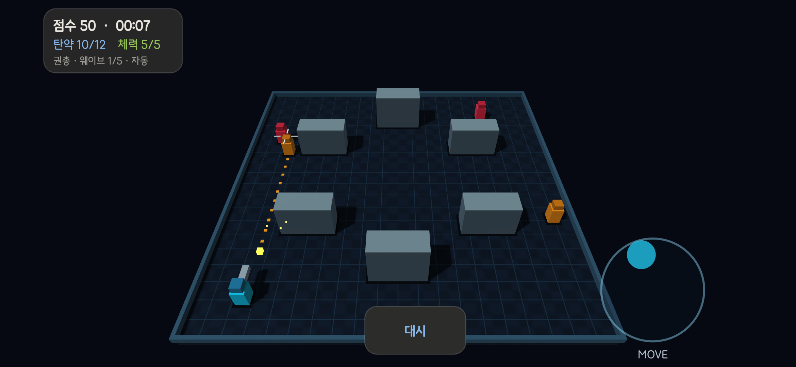

# GLES Arena Demo

Android용 **Kotlin + C++ OpenGL ES 3D 렌더링 데모**.
작은 생존 슈터를 통해 GLES 렌더링, 압축 텍스처, 공통 모듈과 최적화를 실험합니다.



## 기능

- GLES **3.2 → 3.1 → 3.0** 컨텍스트 폴백, GLSL 320/310/300.
- GPU 인스턴싱, 프레임 UBO, 1024² 실시간 그림자와 PCF 필터.
- 픽셀별 조명·하이라이트·윤곽광·안개, 탄환·파티클 발광 표현.
- 지원 기기에서 4× 창 MSAA와 최대 8× 이방성 필터링.
- ETC1 / ETC2 / EAC / ASTC 압축 텍스처 업로드·검증 공통화.
- 그래픽 설정에서 자동·ETC1·ETC2·ASTC 선택, 미지원 형식 자동 대체.
- 자동 사격 또는 양손 조준, 스틱 위치 전환, 대시와 엄폐물 충돌.
- 권총·산탄총·기관단총, 적 조합, 5개 웨이브, 강화 선택, 기록 저장.
- 공통 UI 테마·선택창·HUD·게임 오버 화면.
- C++ ThinLTO·미사용 코드 제거·장면 메모리 재사용, R8 코드·리소스 최적화.

직접 Vulkan을 호출하지 않습니다. 기기 드라이버는 GLES를 ANGLE/Vulkan으로
처리할 수 있습니다. 정상 출력은 기본 프레임버퍼로 직접 렌더링하며,
그림자용 깊이 타깃을 별도로 사용합니다. Compute/fragment 복사 경로는 진단용입니다.

## 빌드

| 항목 | 설정 |
|---|---|
| Android | min SDK 28 / target·compile SDK 37 |
| Java | JDK 25 |
| Gradle / AGP | 9.6.0 / 9.3.1, AGP 내장 Kotlin |
| Native | NDK 30.0.15729638 / CMake 4.1.2 / C++17 |
| ABI | arm64-v8a, x86_64 |
| GPU | OpenGL ES 3.0 이상 |

Android Studio에서 프로젝트를 열고 필요한 SDK·NDK·CMake를 설치합니다.
JAVA_HOME은 JDK 25, ANDROID_HOME은 로컬 Android SDK 경로로 설정합니다.

```powershell
./gradlew.bat :app:assembleBenchmark --no-daemon
adb install -r app/build/outputs/apk/benchmark/app-benchmark.apk
adb shell am start -n dev.demo.arena/.MainActivity
```

benchmark는 최적화를 켠 설치 가능한 로컬 검증 빌드입니다. 로컬 debug 키로
서명되며, 측정 하네스나 제품 배포용 서명 설정은 아닙니다.
개발용 빌드는 :app:assembleDebug를 사용합니다.

## 모듈

- **공통:** GL 지원 정보, 텍스처 검증·업로드·샘플링, 셰이더 생성.
- **확장:** 지원 여부에 따른 드라이버 진단·비동기 GPU 타이머·이방성 필터링.
- **렌더링:** ScenePipeline의 인스턴스·UBO·그림자·조명, GlesRenderer의 EGL 수명 관리.
- **게임:** C++ 시뮬레이션·충돌·전투·진행, GL과 독립된 SceneBuilder.
- **UI:** Kotlin 입력·오디오·설정·공통 선택창·결과 화면.

[모듈 구조](MODULES.md) · [공통 최적화](UNIFIED_MODULES.md) ·
[렌더링 상세](ADVANCED_RENDERING.md) · [ETC 텍스처](ETC_TEXTURES.md) ·
[확장 기능](GLES_EXTENSIONS.md) · [게임 설계](GAME_DESIGN.md)

## 검증 범위

- GLES 3.0 에뮬레이터: 이전 기본 게임·입력·화면 검증.
- Galaxy S24 (SM-S921N), Android 17: GLES 3.2 실제 실행, 최신 조명·그림자·압축 텍스처 확인.
- S24 native 검사: 게임 로직, ETC/EAC 11개 포맷 업로드, GLSL 300/320 장면,
  ETC1/ETC2/ASTC 디코딩·공통 필터링·그림자 경로 및 폴백 검사 통과.
- 최신 인스턴싱/그림자의 GLSL 300 검사는 GLES 3.2 드라이버에서 수행했습니다.
  최신 전체 기능을 GLES 3.0 전용 기기에서 확인한 것은 아닙니다.
- GPU 시간 샘플은 장면 처리 시간이며 터치 지연이나 장시간 성능 보증이 아닙니다.
- 코덱별 같은 렌더링 효과를 지원하지만 압축률·화질·속도는 다를 수 있습니다.

테스트 소스는 tests/, Android 입력 검사는 app/src/androidTest/에 있습니다.
압축 텍스처 API는 이미 압축된 밉 데이터를 받습니다. 일반 이미지 인코더나 KTX
로더는 포함하지 않으며, 바닥 패턴은 데모용 상수 블록으로 생성합니다.

## 서드파티 고지

ASTC 참고 코드의 Apache-2.0과 OpenIntelligentUI 테마의 MIT 고지를 보존합니다.
[THIRD_PARTY_NOTICES.md](THIRD_PARTY_NOTICES.md)를 참고하세요.
로컬 참고 프로젝트, 첨부 파일, 빌드 산출물과 기기 캡처 원본은 저장소에서 제외합니다.
